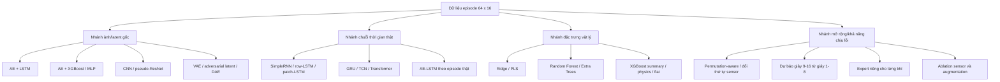
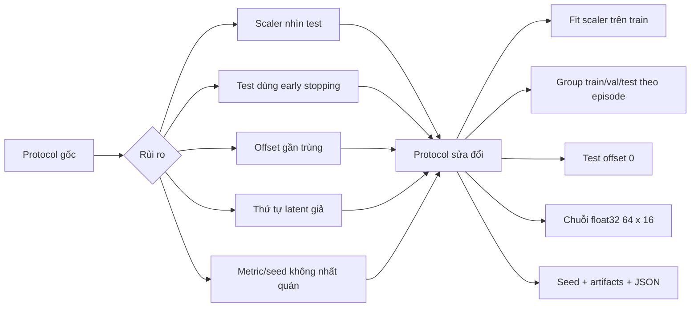
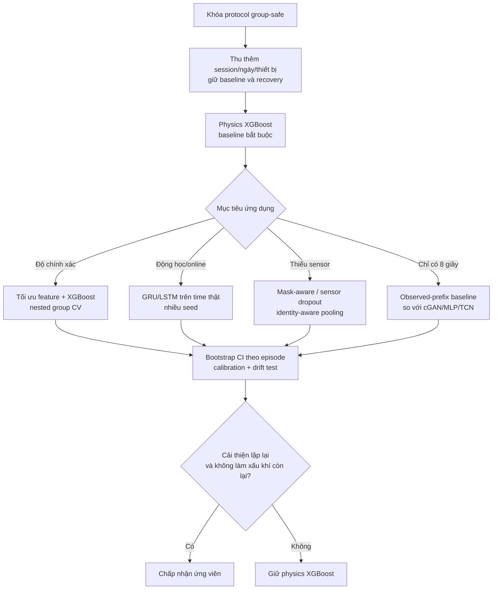

# BÁO CÁO TỔNG HỢP DỰ ĐOÁN NỒNG ĐỘ CO VÀ ETHYLENE

**Nguồn tổng hợp:** `split-to-5-lstm-co-ethy.ipynb` và `EC.md`  
**Ngày tổng hợp:** 20/07/2026  
**Quy ước:** các kết quả đã lưu trong notebook ban đầu được xem là đúng theo giả thiết của đề bài. Các kết quả trong `EC.md` được dùng để mô tả quá trình tái lập, sửa quy trình và các thí nghiệm tiếp theo; chúng không phủ định kết quả lịch sử vì giao thức đánh giá đã thay đổi.

## 1. Tóm tắt điều hành

Bài toán là hồi quy đồng thời nồng độ CO và ethylene từ 16 cảm biến oxide kim loại. Hướng ban đầu biến chuỗi cảm biến thành ảnh xám 64 × 64, nén ảnh bằng autoencoder (AE), sau đó đưa latent 256 chiều vào LSTM để dự đoán hai khí. Theo bảng năm fold được lưu trong notebook, AE–LSTM đạt trung bình **CO MAE 16,014 ppm, R² 0,9791** và **ethylene MAE 0,637 ppm, R² 0,9586**.

Quá trình rà soát và mở rộng trong `EC.md` cho thấy kết quả lịch sử rất tốt nhưng giao thức ban đầu có rò rỉ dữ liệu, scaler không nhất quán và thứ tự thời gian của latent không có ý nghĩa vật lý. Khi chuyển sang đánh giá theo episode, chỉ fit scaler trên train và chỉ chấm offset 0, mô hình **XGBoost trên đặc trưng vật lý** cho cân bằng tốt nhất: **CO MAE 14,604 ± 3,613 ppm; ethylene MAE 0,443 ± 0,178 ppm**. Extra Trees tốt hơn một chút nếu chỉ ưu tiên CO; GRU là mô hình chuỗi tốt nhất đã thử nhưng kém ổn định hơn.

Kết luận hiện tại: giữ kết quả AE–LSTM ban đầu như mốc lịch sử; dùng **physics-feature XGBoost** làm baseline vận hành/nghiên cứu chính; chỉ nâng cấp sang mô hình sâu hoặc sinh dữ liệu khi có thêm episode độc lập, nhiều session/ngày/thiết bị và một cải thiện lặp lại được qua nhiều seed.

## 2. Dữ liệu và pipeline gốc

| Hạng mục | Giá trị |
|---|---:|
| Dòng dữ liệu thô | 4.208.261 |
| Số cột | 19 (thời gian, 2 nhãn, 16 cảm biến) |
| Dòng cả hai khí bằng 0 | 1.249.996 |
| Dòng có khí hoạt động | 2.958.265 |
| Episode ban đầu | 277 |
| Episode sau khi bỏ đoạn dưới 6.400 mẫu (~64 s) | 245 |
| Chia dữ liệu | 5 split × 49 episode |
| Mẫu sau tăng cường | 1.225 ảnh; 245 ảnh/split |
| Miền CO | 0–533,33 ppm |
| Miền ethylene | 0–20 ppm |

```mermaid
flowchart LR
    A[ethylene_CO.txt<br/>4.208.261 x 19] --> B[Lọc dòng thiếu và<br/>hai khí cùng bằng 0]
    B --> C[Tách episode theo<br/>thay đổi nồng độ]
    C --> D[Bỏ episode dưới 6.400 mẫu<br/>còn 245 episode]
    D --> E[Chia 5 split<br/>49 episode mỗi split]
    E --> F[Min-Max 16 cảm biến]
    F --> G[Lấy 64 mốc thời gian<br/>cách nhau khoảng 1 giây]
    G --> H[Lặp 16 cột x4<br/>ảnh 64 x 64]
    H --> I[5 offset: 0, 20, 40, 60, 80]
    I --> J[AE: ảnh thành latent 256]
    J --> K[Reshape 16 x 16]
    K --> L[LSTM hai tầng]
    L --> M[CO và ethylene]
```

Điểm đúng đắn quan trọng của thiết kế gốc là chia theo episode thay vì theo từng dòng, giữ toàn bộ tín hiệu của một lần đo trong cùng split. Cửa sổ 64 giây cũng giữ được động học đáp ứng thay vì chỉ dùng một thời điểm. Tuy nhiên năm ảnh offset của cùng episode gần như trùng nhau, còn việc lặp cột cảm biến chỉ tạo ảnh vuông chứ không thêm thông tin.

## 3. Các hướng logic đã triển khai

### 3.1 Nhánh ảnh và latent

- **AE–LSTM gốc:** AE 4,54 triệu tham số nén ảnh 64 × 64 xuống 256 chiều; latent được reshape thành 16 bước × 16 đặc trưng; LSTM 128/64 units và đầu ra hai nồng độ.
- **AE–XGBoost và AE–MLP:** kiểm tra liệu latent phù hợp hơn với cây boosting hoặc MLP. Kết quả notebook biến động theo split và không tạo ưu thế ổn định.
- **CNN và “ResNet-8”:** CNN trực tiếp yếu; mạng được gọi ResNet thực tế không có skip connection nên là CNN sâu. Dù có một kết quả tốt, so sánh chưa được kiểm soát đồng nhất.
- **VAE, adversarial latent và DAE:** thử biểu diễn phân phối, regularization latent và khử nhiễu. Các latent không giám sát đều làm giảm hiệu quả so với đặc trưng vật lý; DAE còn làm mất biến thiên liên quan nồng độ.

### 3.2 Nhánh chuỗi thời gian thật

- SimpleRNN, LSTM theo từng hàng ảnh, patch-LSTM và Transformer được thử trong notebook.
- Bản cải tiến giữ trực tiếp tensor float32 **64 bước × 16 cảm biến**, loại bỏ PNG, lượng tử uint8 và thứ tự giả của latent.
- GRU hai tầng là mô hình chuỗi tốt nhất trong benchmark sửa đổi. TCN kém hơn, có thể do receptive field/pooling chưa phù hợp và số episode độc lập còn nhỏ.
- AE-LSTM theo chuỗi episode thật tăng nhẹ khả năng nhận biết chiều tăng/giảm nhưng không cải thiện ổn định sai số nồng độ; một fold lỗi lớn làm phương sai CO cao.

### 3.3 Nhánh đặc trưng và mô hình cổ điển

Ba biểu diễn được thử: `summary` (144 đặc trưng thống kê), `physics` (208 đặc trưng gồm baseline, đáp ứng tương đối, đạo hàm...) và `flat` (1.024 giá trị chuỗi trải phẳng). Các mô hình gồm Ridge, PLS, Random Forest, Extra Trees và XGBoost.

Kết quả cho thấy dữ liệu chỉ có 245 episode phù hợp với đặc trưng gọn và cây boosting hơn mô hình sâu end-to-end. XGBoost + physics cân bằng tốt nhất hai khí; Extra Trees + physics có CO MAE thấp nhất nhưng ethylene kém rõ rệt.

### 3.4 Nhánh độ bền, sinh dữ liệu và chuyên gia

- **Augmentation/sensor ablation:** kiểm tra tác động của offset và loại cảm biến; yêu cầu giữ mọi biến thể của cùng episode trong một fold.
- **Đổi thứ tự cảm biến/permutation-aware:** Deep Sets có tính bất biến tốt hơn nhưng phải đánh đổi độ chính xác; đổi sensor mà không retrain không được xem là an toàn vận hành.
- **Sinh giây 9–16 từ giây 1–8:** cGAN có tín hiệu cải thiện MAE một seed nhưng chưa qua tiêu chuẩn nhiều seed và không thắng đầy đủ các control dự báo. CVAE bị loại.
- **Expert riêng cho từng khí:** tìm mô hình, feature và sensor mask riêng cho CO/ethylene bằng nested group folds; không thắng shared physics-XGBoost và lựa chọn sensor không ổn định.
- **Residual correction sau DAE:** nested validation thường chọn hệ số hiệu chỉnh bằng 0, cho thấy residual không lặp lại đủ tốt để áp dụng ngoài train.

## 4. Kết quả định lượng

### 4.1 Mốc lịch sử AE–LSTM trong notebook

| Test split | CO MAE | CO RMSE | CO R² | Ethylene MAE | Ethylene RMSE | Ethylene R² |
|---:|---:|---:|---:|---:|---:|---:|
| 1 | 21,9753 | 30,0317 | 0,9662 | 0,8409 | 1,5516 | 0,8999 |
| 2 | 14,2897 | 20,2838 | 0,9790 | 0,4639 | 0,7700 | 0,9783 |
| 3 | 14,4531 | 21,7021 | 0,9815 | 0,9944 | 1,2064 | 0,9411 |
| 4 | 14,8889 | 21,2878 | 0,9859 | 0,4876 | 0,7221 | 0,9833 |
| 5 | 14,4610 | 22,1726 | 0,9830 | 0,3984 | 0,5568 | 0,9904 |
| **TB ± SD mẫu** | **16,0136 ± 3,3401** | **23,0956 ± 3,9395** | **0,9791 ± 0,0076** | **0,6370 ± 0,2639** | **0,9614 ± 0,4080** | **0,9586 ± 0,0380** |

CO ổn định hơn ethylene; R² ethylene dao động 0,8999–0,9904, cho thấy lựa chọn episode test ảnh hưởng đáng kể.

### 4.2 So sánh các mô hình lưu trong notebook

| Mô hình | CO MAE / R² | Ethylene MAE / R² | Nhận xét |
|---|---:|---:|---|
| CNN | 46,2468 / 0,8346 | 2,1780 / 0,7038 | Yếu nhất trong bảng |
| Pseudo-ResNet | 14,9502 / 0,9822 | 0,6617 / 0,9729 | Tốt nhưng không phải ResNet thực sự |
| SimpleRNN | 23,6308 / 0,9597 | 1,5184 / 0,8429 | Không khai thác tốt cấu trúc |
| Row-LSTM | 19,9426 / 0,9630 | 1,5593 / 0,8228 | CO khá, ethylene yếu |
| Patch-LSTM | 11,2317 / 0,9895 | 1,6995 / 0,8101 | Tốt nhất CO, kém ethylene |
| Transformer | 18,5196 / 0,9709 | 0,8768 / 0,8929 | Chưa vượt mốc AE–LSTM |

Các số trên mang tính mô tả vì seed, scaler, split, early stopping và biến `model` không được khóa thành một manifest thí nghiệm duy nhất.

### 4.3 Benchmark theo giao thức group-safe

| Mô hình | CO MAE | CO R² | Ethylene MAE | Ethylene R² | Quyết định |
|---|---:|---:|---:|---:|---|
| Physics XGBoost | **14,604 ± 3,613** | 0,9681 ± 0,0243 | **0,443 ± 0,178** | 0,9670 ± 0,0424 | Khuyến nghị cân bằng |
| Physics Extra Trees | **14,236 ± 4,334** | 0,9732 ± 0,0261 | 0,955 ± 0,239 | 0,8803 ± 0,0770 | Chỉ khi ưu tiên CO |
| GRU | 14,511 ± 7,589 | 0,9512 ± 0,0669 | 0,580 ± 0,336 | 0,9319 ± 0,0704 | Chuỗi tốt nhất, thiếu ổn định |
| TCN | 22,904 ± 10,824 | 0,9275 ± 0,0912 | 0,797 ± 0,362 | 0,9189 ± 0,0780 | Không chọn |
| AE–LSTM sửa đổi, split 4 | 40,123 | 0,8432 | 1,650 | 0,8186 | Mốc trung gian, không chọn |

Không so sánh trực tiếp tuyệt đối bảng này với notebook gốc: giao thức đã bỏ rò rỉ scaler/test-validation, dùng split seed cố định, đánh giá một offset độc lập/episode và giữ group trong validation.

### 4.4 Kết quả các thí nghiệm mở rộng

| Hướng | Kết quả chính | Kết luận |
|---|---|---|
| Deep Sets/permutation-aware | Bất biến hoán vị tốt hơn, MAE kém GRU | Chỉ tiếp tục nếu cần chịu lỗi/thay thứ tự sensor |
| VAE + physics | CO MAE tăng 7,7%; ethylene tăng 10,0% | Loại |
| Seeded VAE/adversarial latent | Mọi biến thể làm ethylene MAE tăng | Loại |
| cGAN dự báo giây 9–16 | Cải thiện điểm MAE ở một seed, chưa thắng đủ control | Ứng viên nghiên cứu, chưa triển khai |
| Gas-specific experts | CO MAE +6,1%; ethylene +6,5% so với control ghép cặp | Không thay shared XGBoost |
| Chronological AE-LSTM | CO MAE 34,718; ethylene 1,231 | Không thay AE-MLP/XGBoost |
| DAE + hybrid/residual | Raw physics thắng cả hai khí ở cả 5 fold | Loại như nâng cấp độ chính xác |

## 5. Các vấn đề phương pháp đã phát hiện

1. Scaler cảm biến được fit riêng trên từng split, làm test cung cấp min/max cho chính nó.
2. Target scaler train và test khác nhau nhưng prediction lại inverse bằng scaler test.
3. Test được dùng làm validation/early stopping, gây thiên lệch lạc quan.
4. Validation theo ảnh có thể tách năm offset gần trùng của một episode sang hai phía.
5. 16 sensor bị lặp bốn lần và lượng tử thành PNG uint8, tạo hình học ảnh nhân tạo và mất chính xác.
6. Latent dense 256 chiều không có thứ tự thời gian tự nhiên; reshape 16 × 16 không biến nó thành chuỗi vật lý.
7. NRMSE dùng nhiều định nghĩa khác nhau giữa các cell.
8. Notebook thiếu seed và manifest, biến mô hình bị ghi đè, một số cell không chạy top-to-bottom.
9. Năm offset test làm mỗi episode vật lý được đếm năm lần; khoảng tin cậy phải bootstrap theo episode.

## 6. Quyết định kỹ thuật và lộ trình

### 6.1 Quyết định hiện tại

- **Mốc lịch sử:** bảo lưu bảng AE–LSTM năm fold của notebook theo giả thiết đề bài.
- **Baseline khuyến nghị:** physics-feature XGBoost, vì cân bằng hai khí, huấn luyện nhanh và ổn định hơn mô hình sâu trên 245 episode.
- **Phương án CO chuyên biệt:** Extra Trees có thể dùng khi chi phí sai số CO quan trọng hơn ethylene.
- **Phương án chuỗi:** GRU là ứng viên chính nếu dữ liệu episode độc lập tăng đáng kể.
- **Không chọn hiện tại:** AE/VAE/DAE latent, TCN hiện tại, expert tách khí, chronological AE-LSTM và CVAE.
- **Ứng viên thăm dò:** cGAN cho bài toán chỉ quan sát 8 giây, nhưng phải lặp ít nhất 5 seed và thắng persistence/MLP/TCN control trước khi chấp nhận.

### 6.2 Thứ tự ưu tiên tiếp theo

Các tiêu chí bắt buộc cho lần thử tiếp theo: scaler chỉ fit trên train; outer/inner split theo episode hoặc session; mọi offset cùng group; báo cáo MAE, RMSE, R², bias, P90/P95 và bootstrap 95% CI; tối thiểu năm seed cho neural/generative model; lưu mapping fold, seed, package version, prediction và metric JSON.

## 7. Kết luận

Chuỗi nghiên cứu đã đi từ biểu diễn ảnh + AE–LSTM sang chuỗi thời gian thật, đặc trưng vật lý, mô hình cây, mô hình bất biến hoán vị, sinh phần tín hiệu tương lai, chuyên gia theo khí và khử nhiễu. Kết quả tổng hợp nhất quán ở một điểm: với chỉ 245 episode độc lập, biểu diễn vật lý gọn kết hợp XGBoost tổng quát hóa tốt và ổn định hơn phần lớn kiến trúc sâu phức tạp.

AE–LSTM ban đầu vẫn là một mốc lịch sử có giá trị và cho thấy cảm biến chứa tín hiệu rất mạnh về nồng độ. Tuy nhiên lựa chọn kỹ thuật hiện tại nên dựa trên giao thức group-safe: **physics-feature XGBoost là mô hình được khuyến nghị**, còn cải tiến sâu tiếp theo cần được chứng minh trên dữ liệu độc lập theo session/ngày/thiết bị, qua nhiều seed và khoảng tin cậy theo episode.

---

*Tài liệu này tổng hợp có chọn lọc từ notebook và `EC.md`; số liệu lịch sử và số liệu theo giao thức sửa đổi được ghi nhãn riêng để tránh diễn giải như cùng một thí nghiệm.*
