# Sensor-Aware Self-Supervised Transfer Learning for Label-Efficient Multigas Electronic-Nose Calibration

**Author(s):** *[Insert author names]*  
**Affiliation(s):** *[Insert affiliations]*  
**Corresponding author:** *[Insert contact]*

## Abstract

Electronic-nose calibration requires controlled exposures and concentration labels, while unlabeled sensor responses are comparatively inexpensive. This paper proposes same-system sensor-aware transfer learning for two-output gas-concentration regression. A shared dilated temporal convolutional network encodes each response curve, learned identity embeddings retain the meaning of each physical channel, and cross-sensor self-attention models array selectivity. The encoder is pretrained without concentration labels by reconstructing masked temporal spans and completely hidden sensors, then frozen or cautiously fine-tuned using a small, coverage-selected calibration set. Leakage-controlled evaluation is performed on two distinct systems: a private, 20-sensor NH3/H2 dataset with a held-out measurement session and the public, 16-sensor UCI CO/ethylene dataset with a held-out chronological block. With all available adaptation pairs, fine-tuned transfer reduces NH3 and H2 mean absolute error (MAE) from 18.47 to 14.92 ppm and from 36.60 to 29.16 ppm, respectively. For CO/ethylene, the target-dependent best transfer policy reduces CO MAE from 65.00 to 46.16 ppm and ethylene MAE from 1.992 to 1.371 ppm. Benefits are largest in low-label settings, although physics-feature XGBoost remains competitive for CO with at least 20 representative calibration pairs. These results support same-system unlabeled pretraining across two gas pairs and sensor arrays, but do not establish universal cross-device transfer.

**Index Terms—** electronic nose, gas sensing, masked reconstruction, self-supervised learning, sensor arrays, transfer learning, regression.

## I. Introduction

Electronic noses infer chemical composition from the joint, time-dependent response of partially selective sensors. Their practical bottleneck is calibration: obtaining ground-truth concentration labels requires controlled gas delivery, repeated chamber exposures, and often renewed measurements after a sensor, device, or acquisition session changes. A high-capacity supervised model can therefore be accurate while remaining costly to deploy.

Unlabeled responses are easier to collect, but they are useful only if a representation respects the structure of a sensor array. Treating channels as interchangeable discards physical identity; flattening the array ignores response dynamics; and direct transfer between unrelated gases or hardware can impose the wrong inductive bias. The working hypothesis of this study is narrower and testable: unlabeled measurements from the same sensor system can teach temporal response structure and intersensor relationships that reduce the labeled calibration burden.

We propose a sensor-aware masked autoencoder followed by low-label regression. Its shared temporal convolution learns response shapes, identity embeddings distinguish physical channels, and a Transformer-style attention module [1] models relationships among sensor tokens. Temporal-span masking asks the encoder to interpolate dynamics, whereas full-sensor masking asks it to reconstruct one channel from the rest of the array.

The contributions are:

1. A sensor-aware temporal and cross-channel encoder for two-gas regression.
2. A self-supervised objective combining temporal-span and complete-sensor reconstruction.
3. A leakage-controlled protocol separating unlabeled pretraining, labeled adaptation, and untouched testing at the raw-exposure level.
4. Replication on two different gas pairs and sensor-array sizes: public CO/ethylene and private NH3/H2.
5. Label-budget, adaptation-policy, tail-error, and matched traditional-baseline analyses.

The claim is deliberately bounded. Each dataset is pretrained and adapted within its own physical sensor system. Cross-system consistency shows that the method is not specific to one gas pair or array size; it is not evidence that an encoder trained on one array transfers directly to the other.

## II. Methodology

### A. Problem Formulation

Let one gas exposure be a multichannel sequence

$$
X_i\in\mathbb{R}^{T\times S},\qquad y_i=[y_{i1},y_{i2}]^\top\in\mathbb{R}^{2},
$$

where $T=64$ time samples and $S$ is 20 for NH3/H2 or 16 for CO/ethylene. The data are divided by raw exposure into an unlabeled pretraining set $\mathcal U$, a labeled adaptation pool $\mathcal A$, and an untouched test set $\mathcal T$. For label budget $K$, farthest-point coverage sampling produces $\mathcal A_K\subseteq\mathcal A$ from normalized two-gas concentration space.

An encoder $f_\theta$ is learned from $\mathcal U$ without gas labels. A regression head $g_\phi$ is then fit using $\mathcal A_K$ so that

$$
(\theta^*,\phi^*)=\arg\min_{\theta,\phi}
\frac{1}{|\mathcal A_K|}\sum_{(X_i,y_i)\in\mathcal A_K}
\ell_{\mathrm{Huber}}\!\left(g_\phi(f_\theta(X_i)),y_i\right),
$$

subject to one of three policies: random initialization (scratch), fixed pretrained $\theta$ (frozen), or pretrained $\theta$ updated at a smaller learning rate (fine-tuned). Test data are absent from scaling, pretraining, pair selection, and fitting.

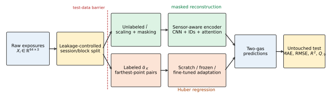

**Fig. 1.** Full sensor-aware pretraining, adaptation, and evaluation pipeline.

### B. Preprocessing and Coverage-Based Calibration

A robust scaler is fit per sensor using pretraining windows only, then reused unchanged. Multiple windows from the same exposure are augmentation, not independent samples: all remain in one task partition. At test time only the offset-zero window is scored, making the evaluation unit one raw exposure.

Small adaptation sets are chosen by seeded farthest-point sampling. After normalizing each gas coordinate, the next concentration pair maximizes its minimum Euclidean distance from the already selected set. This produces wider concentration coverage than an arbitrary small subset. Seeds 42, 142, and 242 vary the ordering and neural initialization while leaving the partitions and test exposures fixed.

### C. Sensor-Aware Encoder

For sensor $s$, the network stacks its scaled signal and observation indicator as two temporal input channels. A shared 1-D CNN maps $2\rightarrow24\rightarrow32\rightarrow32$ features using kernels $(5,5,3)$, dilations $(1,2,4)$, and GELU activation. Mean and maximum pooling are concatenated and projected to a 32-dimensional token. A learned vector $e_s\in\mathbb{R}^{32}$ is added to identify the physical channel. Two pre-normalized Transformer layers, each with four attention heads, 96 hidden feed-forward units, and 0.1 dropout, then model cross-sensor interactions. The regression head flattens the sensor tokens and applies widths $32S\rightarrow128\rightarrow32\rightarrow2$ with GELU and 0.15 dropout.

### D. Sensor-Aware Masked Reconstruction

For a batch $X\in\mathbb{R}^{B\times T\times S}$, let $M$ be a binary visibility mask. Each example receives three temporal spans. Span width $w_k$ is sampled uniformly from 6 to 16, start $a_k$ is uniformly valid, and every sensor is selected independently with probability 0.45:

$$
M_{bts}=0\quad\text{if}\quad a_k\le t<a_k+w_k\ \text{and}\ Z_{bks}=1,
\qquad Z_{bks}\sim\mathrm{Bernoulli}(0.45).
$$

In addition, $c_b\sim\mathcal U\{1,2,3\}$ sensor identities are hidden for the entire sequence. The model receives $[X\odot M,M]$, so a real zero differs from a masked value. With reconstruction $\widehat X$, pretraining minimizes

$$
\mathcal L_{\mathrm{SSL}}=
\frac{\sum(1-M)(\widehat X-X)^2}{\max(1,\sum(1-M))}
+0.05\frac{\sum M(\widehat X-X)^2}{\sum M}.
$$

Temporal masks encourage response-curve modeling; complete-sensor masks require cross-channel inference. Pretraining uses 60 AdamW epochs, learning rate $8\times10^{-4}$, and weight decay $10^{-4}$.

### E. Supervised Policies and Baselines

All neural policies use the same architecture and 120 epochs with Huber loss ($\delta=0.1$). Scratch uses AdamW at $5\times10^{-4}$. Frozen transfer trains only the head at $10^{-3}$. Fine-tuning uses $8\times10^{-5}$ for the encoder and $8\times10^{-4}$ for the head. Weight decay is $2\times10^{-4}$, maximum batch size is 64, and gradients are clipped at norm 2.

Traditional pipelines convert each response into deterministic temporal/physics descriptors before tree regression. CO/ethylene uses 13 descriptors per sensor with XGBoost (800 trees, depth 3, learning rate 0.03) [2]. NH3/H2 is evaluated with Extra Trees [3] and a matched XGBoost pipeline using 37 descriptors per sensor. Every matched comparison uses identical calibration subsets and untouched test exposures.

### F. Metrics

For target $j$ over $N$ held-out exposures,

$$
\mathrm{MAE}_j=\frac1N\sum_i|y_{ij}-\hat y_{ij}|,
\quad
\mathrm{RMSE}_j=\sqrt{\frac1N\sum_i(y_{ij}-\hat y_{ij})^2},
$$

$$
R_j^2=1-\frac{\sum_i(y_{ij}-\hat y_{ij})^2}{\sum_i(y_{ij}-\bar y_j)^2},
\qquad
Q_{0.9,j}=\operatorname{quantile}_{0.9}(|y_{ij}-\hat y_{ij}|).
$$

MAE, RMSE, and $R^2$ are reported as mean $\pm$ standard deviation over three repeats. $Q_{0.9}$ is recomputed from the pooled held-out predictions across the same repeats; this preserves all 189 NH3/H2 or 147 CO/ethylene prediction errors per policy at full budget. Percentage improvement over baseline error $E_b$ is $100(E_b-E_p)/E_b$.

### G. Validation Design

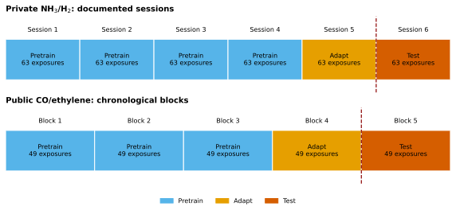

**Fig. 2.** Session-based NH3/H2 split and chronological CO/ethylene split.

NH3/H2 uses documented sessions 1–4 for unlabeled pretraining, session 5 for adaptation, and session 6 for testing. CO/ethylene lacks documented session identifiers in the prepared source; its 245 chronological runs are divided into five contiguous blocks of 49: blocks 1–3 pretrain, block 4 adapts, and block 5 tests. The latter is a future-block evaluation, not proof of transfer between independently documented sessions.

## III. Data and Experiments

### A. Public CO/Ethylene Data

The public source is the UCI *Gas Sensor Array under Dynamic Gas Mixtures* dataset [4], which records a 16-sensor array exposed to varying binary mixtures; UCI reports ethylene at 0–20 ppm and CO at 0–600 ppm. The repository’s prepared CO/ethylene subset contains 245 chronological exposure runs and 1,225 windows. Each exposure contributes five 64-sample windows at offsets 0, 20, 40, 60, and 80. The 49-run adaptation block contains 24 unique concentration pairs. Pretraining uses 147 exposures (735 windows), adaptation uses one exposure per selected pair with five-window augmentation, and testing uses 49 independent offset-zero windows.

### B. Private NH3/H2 Data

The private workbook contains 162,404 rows, 378 exposures, six repeated sessions of 63 exposures, and 20 sensor channels. Each session contains 57 unique concentration pairs; six of 63 exposures repeat a pair. Eleven transition rows carried an adjacent exposure label, so each exposure’s modal $(\mathrm{NH_3},\mathrm{H_2})$ pair was used to correct them. Sessions 1–4 yield 252 exposures and 1,260 windows at offsets 0–4. Session 5 supplies adaptation pairs and five windows per selected exposure. Session 6 supplies 63 independent offset-zero tests. Because the data are private, reproduction requires authorized access to the workbook; the split logic, model code, predictions, and aggregate artifacts remain locally traceable.

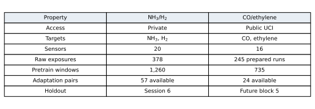

**Fig. 3.** Dataset structure and experimental role.

### C. Budgets and Data Isolation

| Dataset | Pretraining | Adaptation pool | Untouched test | Labeled-pair budgets |
|---|---:|---:|---:|---|
| NH3/H2 | 252 exposures; 1,260 windows | 63 exposures; 57 unique pairs | 63 exposures | 5, 10, 20, 40, 57 |
| CO/ethylene | 147 exposures; 735 windows | 49 exposures; 24 unique pairs | 49 exposures | 5, 10, 20, 24 |

At the smallest budget, only 1.32% of all NH3/H2 exposures or 2.04% of all prepared CO/ethylene exposures provide supervised labels. The corresponding full adaptation budgets use 15.08% and 9.80%, respectively. Scaling is fit only on pretraining windows; concentration labels from pretraining partitions are never supplied to the encoder.

### D. Experimental Configuration

| Stage | Epochs | AdamW learning rate | Weight decay | Objective |
|---|---:|---|---:|---|
| Masked pretraining | 60 | $8\times10^{-4}$ | $10^{-4}$ | masked MSE + 0.05 visible MSE |
| Scratch regression | 120 | $5\times10^{-4}$ | $2\times10^{-4}$ | Huber, $\delta=0.1$ |
| Frozen head | 120 | $10^{-3}$ | $2\times10^{-4}$ | Huber, $\delta=0.1$ |
| Fine-tuning | 120 | encoder $8\times10^{-5}$; head $8\times10^{-4}$ | $2\times10^{-4}$ | Huber, $\delta=0.1$ |

## IV. Results and Discussion

### A. Self-Supervised Training

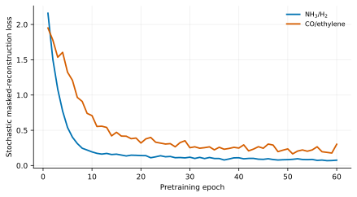

**Fig. 4.** Self-supervised pretraining loss. A new stochastic mask is drawn each epoch.

NH3/H2 loss falls from 2.1595 to 0.0762 over 60 epochs. CO/ethylene falls from 1.9505 to a minimum of approximately 0.165 at epoch 51 and finishes at 0.3020. The late CO/ethylene rise is not a validation regression: the loss uses a newly sampled mask each epoch, so its difficulty varies. The original artifacts did not persist supervised histories. The expanded runner now records epoch-level training and adaptation-only validation loss, best epoch, and selected checkpoint for every ablation and fold without using test observations.

### B. Label Efficiency and Policy Ablation

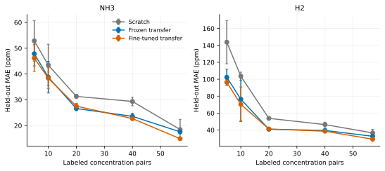

**Fig. 5.** NH3/H2 held-out-session MAE (mean $\pm$ standard deviation, three repeats).

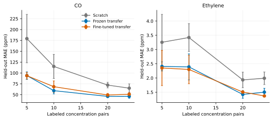

**Fig. 6.** CO/ethylene future-block MAE (mean $\pm$ standard deviation, three repeats).

The complete mean-MAE results are:

| Dataset/target | Pairs | Scratch | Frozen | Fine-tuned | Best transfer gain vs scratch |
|---|---:|---:|---:|---:|---:|
| NH3 | 5 | 52.87 | 47.85 | **46.16** | 12.7% |
| NH3 | 10 | 43.46 | 38.78 | **38.39** | 11.7% |
| NH3 | 20 | 31.33 | **26.61** | 27.54 | 15.1% |
| NH3 | 40 | 29.35 | 23.58 | **22.71** | 22.6% |
| NH3 | 57 | 18.47 | 17.57 | **14.92** | 19.2% |
| H2 | 5 | 143.82 | 102.36 | **96.43** | 33.0% |
| H2 | 10 | 103.62 | 76.42 | **70.36** | 32.1% |
| H2 | 20 | 53.79 | **40.93** | 41.23 | 23.9% |
| H2 | 40 | 46.42 | 39.52 | **38.62** | 16.8% |
| H2 | 57 | 36.60 | 32.61 | **29.16** | 20.3% |
| CO | 5 | 179.17 | 93.99 | **93.79** | 47.7% |
| CO | 10 | 115.06 | **59.27** | 68.42 | 48.5% |
| CO | 20 | 72.11 | **46.06** | 49.27 | 36.1% |
| CO | 24 | 65.00 | **46.16** | 51.07 | 29.0% |
| Ethylene | 5 | 3.255 | 2.407 | **2.352** | 27.7% |
| Ethylene | 10 | 3.422 | 2.391 | **2.301** | 32.8% |
| Ethylene | 20 | 1.934 | **1.424** | 1.507 | 26.4% |
| Ethylene | 24 | 1.992 | 1.503 | **1.371** | 31.2% |

Scratch, frozen, and fine-tuned policies form a controlled adaptation ablation: architecture, partitions, label selection, and epoch budget are held constant. The preferred policy is target- and budget-dependent: fine-tuning wins NH3/H2 at 5 and 10 pairs, freezing narrowly wins at 20, and fine-tuning wins again at 40 and 57; CO is essentially tied at 5 pairs but favors freezing thereafter; ethylene favors fine-tuning except at 20 pairs. Fig. 7 reports the signed fine-tuning gain relative to freezing. Negative values mean that updating the encoder was harmful.

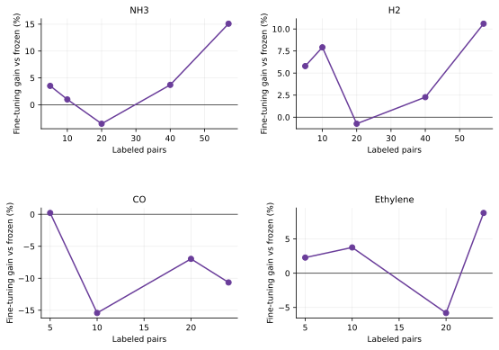

**Fig. 7.** Adaptation-policy ablation. Fine-tuning becomes useful for several targets only after adaptation coverage grows.

The original experiment lacked component-level controls. The expanded study below adds sensor-ID, attention, temporal-mask, and complete-sensor-mask ablations under common splits, budgets, seeds, epoch counts, and adaptation-only checkpoint selection.

### C. Full-Budget Error, Tail Risk, and Prediction Behavior

| Dataset | Policy | Target | MAE (ppm) | RMSE (ppm) | $R^2$ | Pooled $Q_{0.9}$ abs. error (ppm) |
|---|---|---|---:|---:|---:|---:|
| NH3/H2 | Scratch | NH3 | 18.47 $\pm$ 3.95 | 31.06 $\pm$ 11.16 | 0.960 $\pm$ 0.029 | 35.55 |
|  | Frozen | NH3 | 17.57 $\pm$ 0.48 | 23.55 $\pm$ 1.14 | 0.979 $\pm$ 0.002 | 38.98 |
|  | Fine-tuned | NH3 | **14.92 $\pm$ 0.57** | **19.83 $\pm$ 1.35** | **0.985 $\pm$ 0.002** | **33.62** |
|  | Scratch | H2 | 36.60 $\pm$ 4.20 | 52.89 $\pm$ 7.29 | 0.900 $\pm$ 0.028 | 87.19 |
|  | Frozen | H2 | 32.61 $\pm$ 1.81 | 43.36 $\pm$ 2.07 | 0.934 $\pm$ 0.006 | 75.24 |
|  | Fine-tuned | H2 | **29.16 $\pm$ 1.10** | **41.05 $\pm$ 1.09** | **0.941 $\pm$ 0.003** | **71.90** |
| CO/ethylene | Scratch | CO | 65.00 $\pm$ 9.96 | 100.50 $\pm$ 12.20 | 0.576 $\pm$ 0.098 | 183.94 |
|  | Frozen | CO | **46.16 $\pm$ 4.58** | **73.28 $\pm$ 4.87** | **0.776 $\pm$ 0.029** | **118.82** |
|  | Fine-tuned | CO | 51.07 $\pm$ 3.37 | 78.31 $\pm$ 1.79 | 0.745 $\pm$ 0.012 | 128.68 |
|  | Scratch | Ethylene | 1.992 $\pm$ 0.222 | 3.208 $\pm$ 0.208 | 0.577 $\pm$ 0.054 | 7.190 |
|  | Frozen | Ethylene | 1.503 $\pm$ 0.138 | 2.302 $\pm$ 0.065 | 0.783 $\pm$ 0.012 | **3.127** |
|  | Fine-tuned | Ethylene | **1.371 $\pm$ 0.025** | **2.196 $\pm$ 0.051** | **0.802 $\pm$ 0.009** | 3.819 |

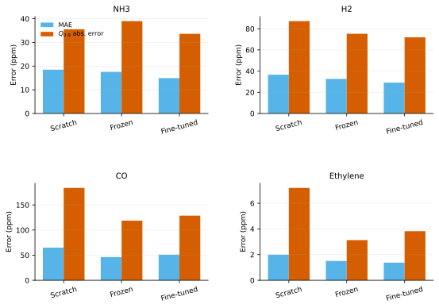

**Fig. 8.** Full-budget central and tail error. Targets are separately faceted because their ppm scales differ.

Transfer reduces both average and large-error behavior in most cases. The ethylene exception is informative: fine-tuning gives the best mean error and $R^2$, but freezing has the lower pooled 90th percentile. Thus model choice may depend on whether deployment prioritizes average accuracy or tail control. Likewise, frozen NH3 slightly improves average error over scratch while its pooled $Q_{0.9}$ is slightly higher; fine-tuning improves both.

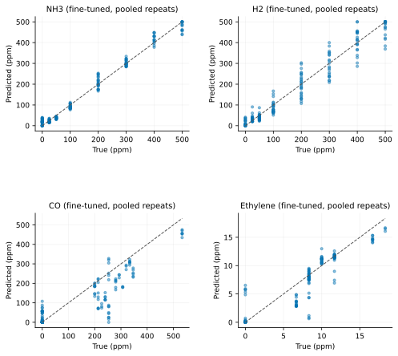

**Fig. 9.** Full-budget fine-tuned predictions pooled over three repeats. The dashed line is ideal agreement.

### D. Comparison with Physics-Feature Models

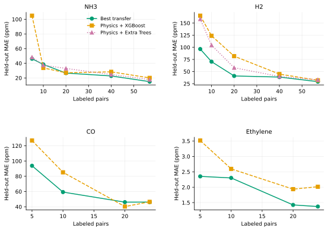

**Fig. 10.** Mean held-out MAE under identical calibration subsets and tests.

For NH3/H2, best transfer beats both Extra Trees and XGBoost in 9 of 10 target-budget comparisons. The exception is NH3 at 10 pairs, where XGBoost obtains 33.67 ppm against transfer’s 38.39 ppm. At 20 NH3 pairs, transfer and XGBoost are nearly tied (26.61 versus 27.00 ppm). At full budget, fine-tuned transfer reaches 14.92/29.16 ppm for NH3/H2, compared with 17.70/33.00 for Extra Trees and 20.07/31.97 for XGBoost.

For CO/ethylene, transfer is especially strong with 5–10 pairs. At 10 pairs, it improves on XGBoost from 85.21 to 59.27 ppm for CO and from 2.595 to 2.301 ppm for ethylene. XGBoost wins CO at 20 pairs (40.29 versus 46.06 ppm) and is effectively tied at 24 pairs (46.44 versus 46.16 ppm). Transfer remains better for ethylene at every budget, including 1.371 versus 2.015 ppm at full budget. Hence learned representations are not uniformly superior to engineered features: a strong tree model can be competitive for CO when concentration coverage is sufficient.

### E. Cross-System Interpretation

The strongest common result is label efficiency. Transfer improves every gas at every evaluated budget relative to scratch when the better frozen/fine-tuned policy is selected. This pattern appears with different gas pairs, sensor counts, split types, and concentration scales. It supports the use of unlabeled same-system measurements as calibration infrastructure.

The target-dependent freezing results suggest a bias–variance trade-off. With few pairs, encoder updates can overfit a narrow concentration manifold; freezing preserves the broader unlabeled representation. With more coverage, fine-tuning aligns features to NH3, H2, and ethylene. CO remains better frozen, implying that its pretrained structure transfers well or that the adaptation block is still insufficient for stable encoder updates.

### F. Expanded Architectural Ablation

The expanded ablation retrains five variants for 60 self-supervised epochs and up to 120 supervised epochs at the 5-pair and full budgets, using three repeats. Twenty percent of adaptation groups select the best checkpoint; the untouched test remains isolated. Because this validation holdout reduces the supervised fitting subset, its absolute values should be compared within the ablation protocol rather than substituted for the original full-adaptation table.

| Dataset/target, full budget | Full | No sensor IDs | No attention | No sensor masking | No temporal masking |
|---|---:|---:|---:|---:|---:|
| NH3 | 16.48 | 16.84 | **14.96** | 16.21 | 20.86 |
| H2 | **28.78** | 37.64 | 31.44 | 30.22 | 33.79 |
| CO | **51.57** | 58.59 | 59.85 | 52.78 | 53.80 |
| Ethylene | **1.625** | 1.873 | 1.631 | 1.851 | 1.629 |

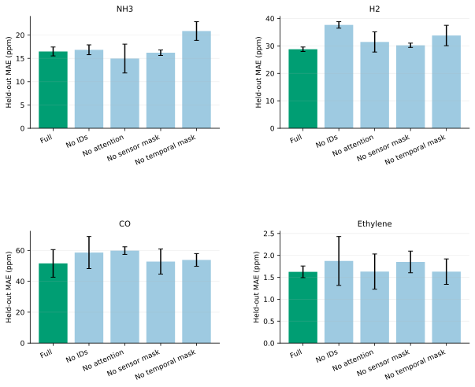

**Fig. 11.** Component ablation MAE (mean $\pm$ standard deviation over three repeats). Enlarged vertical spacing protects axis-label readability.

Sensor identities are important for H2, CO, and ethylene, while temporal masking is important for NH3 and H2. Complete-sensor masking improves H2, CO, and ethylene. Removing attention unexpectedly improves NH3 under this protocol but degrades the other three targets, so attention cannot be claimed to universally improve every gas. The full configuration is best for three of four targets and is the most consistent cross-system compromise.

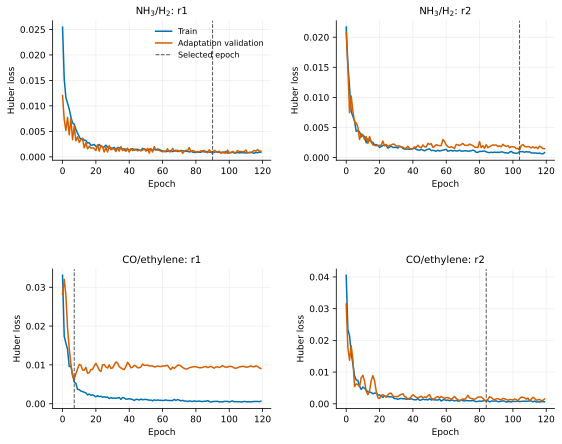

**Fig. 12.** Representative full-model histories. Dashed lines mark checkpoints selected using adaptation-only validation data.

### G. Multi-Session and Rolling Chronological Validation

NH3/H2 was rerun in six leave-one-session-out folds. Each fold holds out one test session, assigns the preceding session (wrapping session 1 to session 6) to adaptation, and uses the other four sessions for unlabeled pretraining. At 57 pairs, scratch obtains 33.01 $\pm$ 17.81 ppm NH3 MAE and 48.78 $\pm$ 19.27 ppm H2 MAE across 18 fold/repeat runs. Transfer reduces these to 27.60 $\pm$ 10.37 and 38.97 $\pm$ 10.13 ppm. Paired exposure-level bootstrap improvement is 5.41 ppm for NH3 (95% CI 3.74–7.10) and 9.81 ppm for H2 (95% CI 7.56–11.94), based on 1,134 paired predictions per gas.

The public source describes continuous acquisition rather than documented independent sessions, so metadata recovery did not yield defensible session boundaries. The replacement protocol uses seven contiguous chronological blocks and three rolling pretrain–adapt–test folds. At the common 20-pair budget, transfer reduces CO MAE from 100.60 $\pm$ 14.13 to 80.07 $\pm$ 41.83 ppm and ethylene MAE from 2.653 $\pm$ 0.500 to 2.267 $\pm$ 0.989 ppm. Paired bootstrap improvements are 20.53 ppm CO (95% CI 10.51–30.45) and 0.386 ppm ethylene (95% CI 0.121–0.661), based on 315 paired predictions per gas.

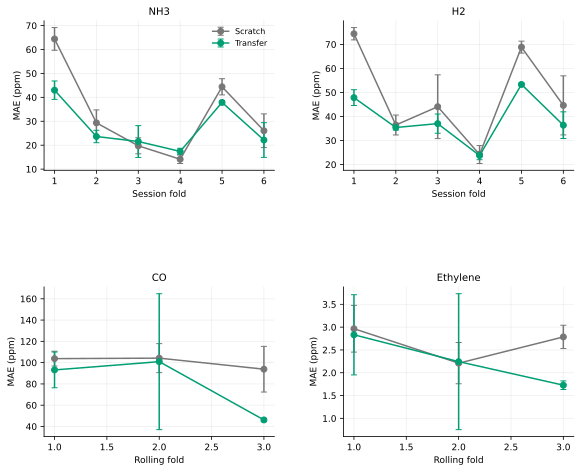

**Fig. 13.** Full-budget NH3/H2 session folds and common-20-pair CO/ethylene rolling folds. Error bars show three-seed variation within folds; enlarged panel spacing prevents label overlap.

Split-conformal 90% intervals were computed from adaptation-only validation residuals. At the NH3/H2 full budget, transfer coverage is 81.3% for NH3 and 71.5% for H2, with mean widths 83.70 and 88.18 ppm. At the common CO/ethylene 20-pair budget, coverage is 59.0% for CO and 63.8% for ethylene, with widths 169.17 and 5.49 ppm. Coverage is below the nominal 90%, revealing session/chronological shift and insufficient calibration data; these intervals are diagnostic and not deployment guarantees.

### H. Limitations and Threats to Validity

1. **Chronological proxy:** CO/ethylene has no recovered session IDs; rolling blocks test future acquisition order, not independent sessions.
2. **Repeated runs:** three seeds quantify optimization and pair-selection variation, but only fold/session changes provide independent acquisition contexts.
3. **Ablation validation size:** reserving 20% of a five-pair adaptation set leaves very little supervised fitting data and makes low-budget selection noisy.
4. **Conformal undercoverage:** small calibration sets and distribution shift produce coverage below the nominal 90%.
5. **Private data:** NH3/H2 raw-data access is restricted, limiting external reproduction.
6. **Device generalization:** neither experiment transfers between different physical arrays.
7. **Operational robustness:** missing/degraded-sensor and edge-latency experiments remain future work.

Future work should improve interval calibration under distribution shift, evaluate missing/degraded sensors, compare active calibration selection, measure deployment latency, and test transfer to another physical e-nose unit.

## V. Conclusion

Sensor-aware masked pretraining consistently improves label-efficient two-gas regression across private NH3/H2 and public CO/ethylene systems. At full budget it reduces scratch MAE by 19.2%/20.3% for NH3/H2 and by 29.0%/31.2% for CO/ethylene using the best target-specific transfer policy. Expanded folds retain statistically positive paired improvements for every gas at the common high budgets. Component ablations support sensor identity and both masking mechanisms across most targets, while the mixed attention result argues against universal component-level claims. Physics-feature XGBoost remains a meaningful competitor for sufficiently covered CO calibration. Cross-device generalization remains open.

## References

[1] A. Vaswani *et al.*, “Attention Is All You Need,” in *Advances in Neural Information Processing Systems 30*, 2017. [Online]. Available: https://papers.neurips.cc/paper/7181-attention-is-all-you-need

[2] T. Chen and C. Guestrin, “XGBoost: A Scalable Tree Boosting System,” in *Proc. 22nd ACM SIGKDD Int. Conf. Knowledge Discovery and Data Mining*, 2016, pp. 785–794, doi: 10.1145/2939672.2939785.

[3] P. Geurts, D. Ernst, and L. Wehenkel, “Extremely randomized trees,” *Machine Learning*, vol. 63, pp. 3–42, 2006, doi: 10.1007/s10994-006-6226-1.

[4] J. Fonollosa, “Gas Sensor Array under Dynamic Gas Mixtures,” UCI Machine Learning Repository, 2015, doi: 10.24432/C5WP4C. [Online]. Available: https://archive.ics.uci.edu/dataset/322/gas+sensor+array+under+dynamic+gas+mixtures

## Reproducibility and Evidence Statement

Aggregate fixed-split results come from `../results/{nh3_h2,co_ethylene}/results.json`; matched XGBoost results come from the corresponding `physics_xgboost_comparison.json`; pooled $Q_{0.9}$ values are recomputed from `predictions.csv`. Expanded ablations, folds, predictions, histories, conformal results, and bootstrap intervals are under `../results/advanced_validation/`. `reproducibility_manifest.json` records source/code checksums, environment versions, and regeneration commands. Figures are SVG and their provenance is listed in `figure_manifest.md`. Numerical claims apply to the saved protocols and should not be generalized beyond their stated partitions.
